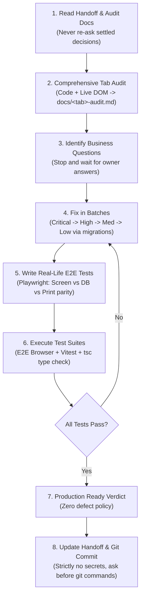

# Swiftforge Screen & Tab Testing Playbook

This playbook documents the exact procedure used to audit, fix, test, and certify the **AWB Entry** and **Proforma** tabs to 100% production readiness. 

Follow this exact procedure for all subsequent tabs (**Forwarding**, **KYC**) and future ERP screens across any AI coding environment (Antigravity, Cursor, Claude Code, etc.).

---

## A. Step-by-Step Testing & Certification Procedure



### 1. Read Prior Documentation First
- Before touching code or proposing changes, read `docs/awb-entry-handoff.md`, `docs/awb-entry-audit.md`, and any prior audit files completely.
- **Do not re-ask questions or re-open decisions already settled** (e.g., international-only scope, Save = Book, Next = advance tab without saving, server is the source of truth, DOX exempt from proforma lines, LUT only from Shipper/Customer/Input, placeholder customs rates).

### 2. Comprehensive Tab Audit (Code + Live DOM)
- Inspect every single element on the tab:
  - Form fields, dropdowns, lookups, radio buttons, checkboxes, action buttons.
  - Client-side validation logic and tab auto-switching behaviors.
  - Rating, tax split, and volumetric calculation formulas.
  - Server-side constraints, RLS policies, and PostgreSQL RPC functions (`book_awb_shipment`).
  - Document generators (HTML invoices, PDF downloads, labels).
- Output the findings into `docs/<tab>-audit.md` using standard defect IDs:
  - Format: ID, status (OPEN/CLOSED), severity (CRITICAL, HIGH, MEDIUM, LOW), title, evidence, file & line reference.
  - **Do NOT begin fixing code during the audit phase**. First catalog all findings completely.

### 3. List Business Questions
- Distinguish between **code defects** (bugs violating stated specs) and **business policy choices** (e.g., KYC mandates, statutory thresholds, third-party vendor fallbacks).
- List all open business questions clearly for the product owner and **wait for explicit answers** before implementing assumptions.

### 4. Fix in Strict Severity Batches
- Fix issues in structured batches:
  1. **Batch 1: Critical / Blocker** (runtime crashes, data corruption, broken persisters).
  2. **Batch 2: High Severity** (incorrect money/tax calculations, broken document outputs, cross-tab state loss).
  3. **Batch 3: Medium Severity** (validation inconsistencies, UX focus trapping, navigation order).
  4. **Batch 4: Low Severity** (copy text, layout polishing, redundant lookups).
- **Architecture Rules**:
  - The PostgreSQL database and RPCs (`book_awb_shipment`) are the **ultimate source of truth**. Never rely solely on client-side React state.
  - Apply database changes via new, sequential, recorded migrations (`supabase/migrations/XXXX_name.sql`). Never modify already-applied migrations.
  - Always write a unit test (`vitest`) for every bug fixed.

### 5. Write Real-Life Playwright E2E Browser Tests
- Write automated Playwright tests that drive the real browser DOM (`http://localhost:8082/...`):
  - Model realistic operator behavior: typing into inputs, tabbing through fields, clicking dropdown options, uploading Excel MTS fixtures, clicking Save/Book, locking/unlocking shipments, and printing invoices.
  - Test the "three-way check":
    1. **Screen state**: Toast messages, active tab switching, calculated totals, disabled states.
    2. **PostgreSQL database**: Query the created row directly via Supabase API and verify exact column parity.
    3. **Printed document**: Verify the HTML/PDF preview output (correct titles, line items, taxes, tax IDs).
  - Include operator mistake tests (invalid emails, missing required fields, mutual exclusivity violations, rapid double-clicks).

### 6. Execute Test Suites & Report Exact Counts
- Run all three verification layers:
  1. Automated E2E Browser tests: `npm run test:e2e:<suite>`
  2. Vitest unit and integration tests: `npx vitest run`
  3. TypeScript compiler check on modified files: `npx tsc --noEmit`
- Report exact numerical counts: `X passed out of X tests across Y files`.

### 7. Final Code Verdict
- Declare **"PRODUCTION READY"** ONLY if 100% of real-life browser test cases pass with zero errors.
- If even one case fails, keep the verdict as **"NOT READY"** and iterate.
- Maintain a separate checklist for non-code business go-live items (e.g., production rate cards, carrier API keys).

### 8. Update Handoff & Version Control
- Update `docs/<tab>-handoff.md` and `docs/production-readiness-test.md`.
- Ensure ignored files (`.env`, `.env.test.local`, `e2e/.auth/`, `test-results/`) are never staged.
- Obtain explicit user permission before executing git commands (`git status`, `git add`, `git commit`). Do not push.

---

## B. Core Working Rules & Guardrails

1. **Environment Separation**:
   - The Supabase project `ijosczggsrvscponules` is strictly the **DEVELOPMENT** database. Real production will be a separate, clean Supabase project.
2. **Test Data Markers**:
   - Every test record, reference number, customer, and rate must start with `TEST_` or `TEST_AWB_` (e.g., `TEST_AWB_R1`, `TEST_AWB_G1`).
3. **No Cleanup Script**:
   - Never run data cleanup scripts (`scripts/awb-audit/cleanup-international-test-data.mjs`) automatically or without explicit user permission.
4. **Pre-Migration Backups**:
   - Before executing schema-altering migrations, create backups in `backups/` (`schema_backup_YYYYMMDD.sql` and `data_backup_YYYYMMDD.sql`).
5. **Single Dev Server**:
   - Ensure only one dev server is running on port `8082`, serving code from the active working branch.
6. **Honest Reporting**:
   - Always differentiate between a real browser DOM test and a node-only server test. Never count server-only checks as screen tests.
7. **Plain Language**:
   - Communicate findings, business logic, and test verdicts in simple, transparent language without jargon.
8. **Stop and Ask**:
   - If blocked by authentication, missing environment variables, or a session timeout, stop immediately and ask the owner.

---

## C. Playwright E2E Infrastructure

### Architecture Overview

```
swiftforge-core/
├── playwright.config.ts          # Playwright configuration (Chromium, port 8082, auth state)
├── .env.test.local               # Test credentials (git-ignored, never committed)
├── e2e/
│   ├── .auth/user.json           # Cached admin auth session state (git-ignored)
│   ├── auth.setup.ts             # Logs into http://localhost:8082/login and saves user.json
│   ├── helpers/
│   │   ├── awbTestHelpers.ts     # Reusable browser actions (fillAwbBasics, addProformaLine, saveAndAssertSuccess)
│   │   └── dbHelpers.ts          # Direct Supabase DEV DB client queries
│   ├── r1.spec.ts to r10.spec.ts # Real-life case specs (R1–R10)
│   └── fixtures/                 # Excel files for bulk upload tests
```

### Test Authentication Setup
Playwright runs a setup project (`auth.setup.ts`) before executing tests:
- Reads `TEST_USER` and `TEST_PASSWORD` from `.env.test.local`.
- Signs in via the real `/login` UI.
- Saves browser storage state (JWT, cookies, local storage) to `e2e/.auth/user.json`.
- All subsequent test specs reuse this session, eliminating login overhead and screen flashing.

### Key Configuration (`playwright.config.ts`)
- **Workers**: Set to `workers: 1`. Tests run serially to prevent database contention on shared test customers (`ALIASSO`, `OSMO`).
- **Base URL**: `http://localhost:8082`.
- **Traces & Screenshots**: Enabled on first retry or failure (`trace: "retain-on-failure"`, `screenshot: "only-on-failure"`).

### How to Add a New Spec for a New Tab
1. Create `e2e/<tab>-<case>.spec.ts`.
2. Import `test` and `expect` from `@playwright/test`.
3. Use `test.beforeEach(async ({ page }) => { await page.goto("/transaction/awb-entry"); });`.
4. Click the target tab trigger:
   ```ts
   await page.getByRole("tab", { name: "FORWARDING" }).click();
   ```
5. Drive fields using `page.locator(...)` or `page.getByLabel(...)`.
6. Assert UI state, database record via `dbHelpers.ts`, and invoice preview.

### Test Commands
```bash
# Run all AWB E2E tests
npm run test:e2e:awb

# Run a specific test spec
npx playwright test e2e/r1.spec.ts

# Run tests in headed UI mode (watch Chromium execute)
npx playwright test --headed

# Open the HTML test report
npx playwright show-report
```

---

## D. Prompt Template for the Next Tab

Use this prompt template to initiate an audit and test cycle for any upcoming tab:

```markdown
We are auditing and testing the [TAB NAME] tab on the AWB Entry screen (http://localhost:8082/transaction/awb-entry).

Follow the exact procedure and rules in docs/testing-playbook.md:
1. Scope & Rules:
   - DEV database only (Supabase project ijosczggsrvscponules).
   - All test data must use TEST_ / TEST_AWB_ prefixes.
   - Do NOT run cleanup scripts.
   - International bookings only.
   - Do not fix any code during the audit phase; audit first, then report.

2. Audit the [TAB NAME] Tab:
   - Fields on this tab: [LIST FIELDS, e.g., Delivery AWB, Forwarding AWB, Delivery Vendor, Vendor Charges, etc.]
   - Inspect every field, validation rule, calculation, database mapping, and document/label output.
   - Write docs/[tab-name]-audit.md detailing all findings with Defect IDs, severity, evidence, and code references.

3. List Business Questions:
   - Identify business rules that require my decision before implementation.

4. Once I approve the answers:
   - Fix findings in severity batches (Critical -> High -> Medium -> Low).
   - Write Playwright E2E browser tests for real-life cases:
     [CASE 1: description]
     [CASE 2: description]
     [CASE 3: description]
   - Verify screen vs database vs print document parity.
   - Run npm run test:e2e:awb, npx vitest run, and npx tsc --noEmit.
   - Update handoff documentation and deliver the final code verdict.
```

---

## E. Next Tabs: Forwarding & KYC

### 1. Forwarding Tab

#### What We Know from Code:
- **Location**: Rendered under `<TabsContent value="forwarding">` at line 7424 in `src/routes/transaction.awb-entry.tsx`.
- **Form State**: Stored in `form.forwarding` and mapped by `shipmentUiMap.ts`:
  - `deliveryAwb`: Delivery AWB number.
  - `forwardingAwb`: Forwarding AWB number.
  - `deliveryVendor`: Vendor object (`{ id, code, name }`).
  - `deliveryProduct`: Product object (`{ id, code, name }`).
  - `deliveryService`: Service lookup pair.
  - `vendorWeight`, `chargeWeight`, `chargeUnit`.
  - `vendorChargeLines`: Array of vendor cost charges (`{ chargeId, name, amount, tax }`).
- **Database Storage**:
  - `shipments.delivery_awb`: Direct column in PostgreSQL.
  - `shipments.forwarding_awb`: Direct column in PostgreSQL.
  - `shipments.wizard_extras -> 'forwarding'`: Stores full forwarding object and vendor charge lines.
- **Navigation Order**: Tab indices defined in `awb-entry-nav-order.ts` (`AWB_NAV.FWD_DELIVERY_AWB: 701`, `FWD_FORWARDING_AWB: 702`, etc.).

#### Known failure for the Forwarding audit (do not treat as fixed):
`e2e/forwarding-audit.spec.ts` books an AWB, then its own database read fails. PostgREST returns PGRST201: “Could not embed because more than one relationship was found for 'shipments' and 'vendors'”. The two links are `shipments_delivery_vendor_fk` and `shipments_vendor_fk`. The hint is to name one: `vendors!shipments_delivery_vendor_fk` or `vendors!shipments_vendor_fk`. The booking itself succeeded. This note is only a record for the Forwarding audit. The spec and the schema are left as they are.

#### Open Questions for the Forwarding Audit:
1. Are `forwardingAwb` and `deliveryAwb` mandatory at booking time, or can an AWB be booked first and forwarded later during dispatch/manifesting?
2. Does entering a vendor AWB require validation against vendor number series or carrier tracking check digits?
3. Should vendor charge lines calculate landed cost and display gross profit margin on screen?
4. When `deliveryVendor` is selected, should it default to the main shipment vendor from the AWB tab?

---

### 2. KYC Tab

#### What We Know from Code:
- **Location**: Rendered under `<TabsContent value="kyc">` at line 7716 in `src/routes/transaction.awb-entry.tsx`.
- **Form State**: Stored in `form.kyc` and mapped by `shipmentUiMap.ts`:
  - `documents`: Array of document objects (`{ documentType, documentNo, fileName, mimeType, contentB64, uploaded }`).
  - Search toolbar: Document search by AWB, Shipper, or Document Number.
- **Database Storage**:
  - `shipments.wizard_extras -> 'kyc' -> 'documents'`: Document metadata and base64 payloads stored inside JSONB.
  - Individual document files can also be saved to `shipment_documents` table via `saveShipmentDocument`.
- **Shipper Document Cross-Sync**:
  - The Shipper section on the AWB tab already holds `documentType` and `documentNo` (Aadhaar, Passport, IEC, GSTIN).
  - KYC tab allows operators to view and attach actual identity proof files.

#### Open Questions for the KYC Audit:
1. What are the mandatory KYC rules per shipment type? (e.g., Is Aadhaar/Passport mandatory for all individual CSB-IV gifts? Is IEC mandatory for CSB-V commercial exports?)
2. Are KYC documents stored as Base64 inside `wizard_extras` or uploaded to a private Supabase Storage bucket (`shipment-kyc-documents`) with signed URLs?
3. Should Aadhaar numbers require masking (showing only last 4 digits) for statutory compliance?
4. Can KYC documents be reused across shipments for the same repeat Shipper?
